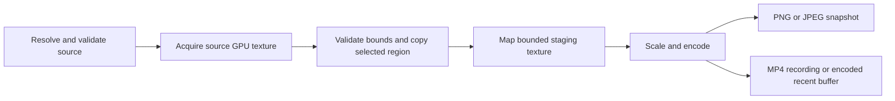

# Proposal: one capture source for screenshots, recordings and recent media

Status: design only. The 0.8.1 release fixes mouse release; it does not implement
these new capture modes. The goal is lower action-to-observation latency and
bounded resource use. Crop at the capture/GPU boundary, before CPU readback,
scaling, PNG/JPEG encoding, H.264 encoding or the encoded ring buffer.

## Common API

Add the same optional `source` union to `hid_capture`, `screen_record_start` and
video/combined `media_buffer_start`. Keep their existing lifecycle and ownership.
Exactly one source mode is allowed:

```json
{"source":{"mode":"fullscreen","display":"primary"}}
{"source":{"mode":"window","title":"Example - Application","match":"exact","area":"client"}}
{"source":{"mode":"region","display":"primary","x":440,"y":165,"width":800,"height":600}}
```

| Mode | Selection and pixels acquired | Coordinate meaning |
|---|---|---|
| fullscreen | Entire primary display, existing DXGI Desktop Duplication backend | Physical host display pixels |
| window | One uniquely resolved host HWND using Windows.Graphics.Capture | Window/client pixels; map back through returned geometry |
| region | A validated rectangle from the primary display's GPU texture | Physical host pixels before scaling, never normalized HID counts |

Omitted `source` retains the existing fullscreen/primary default. Quality,
cursor inclusion, recording duration and audio options remain separate.
Audio-only buffers have no visual source; reject a supplied visual selector
rather than imply that audio is filtered by window. System audio remains the
host render-endpoint loopback, even for a window/region video. No microphone or
automatic per-application audio selection is introduced.

Use exact, case-insensitive window-title matching initially, with an optional
process-ID filter. Zero matches gives `window_not_found`; multiple matches give
`window_ambiguous` and a bounded candidate summary. Never silently pick the first
window. Bind a continuous session to HWND + PID + process creation identity;
subsequent title changes do not retarget it, and a reused HWND is not trusted.

For a host-side KVM, a VMware window is a selectable host window. A game window
inside the guest is not a host HWND. Capture the VMware window or an explicit
host rectangle around the visible guest game; this design adds no guest agent.

## Acquire only the selected pixels



**Fullscreen and region:** continue using the existing monitor duplication.
For region mode use `CopySubresourceRegion` into a staging texture sized to the
selected rectangle. Map/copy only that rectangle. Do not first construct the
current full-screen CPU `Frame`, then crop it. Avoid full-frame vector copies
in `Grab`/`Scale`; share bounded pixel storage where safe. Reuse staging textures
while source identity and dimensions remain stable.

Desktop Duplication still acquires a monitor texture; a rectangular selection
does not instruct Windows to render only that rectangle. The savings are in our
GPU copy, GPU-to-CPU readback, allocations, scaling, encoding and transmitted data.
GPU-side scaling can be evaluated later if measurements show it is worthwhile.

**Window:** use the public `IGraphicsCaptureItemInterop::CreateForWindow` API
to acquire a window texture directly. Crop the requested client area on the GPU
before readback; handle frame borders/DPI explicitly. A monitor crop around an
HWND is an explicitly different fallback: it can contain covering windows. Do
not silently present it as isolated window capture. Check API/SDK availability
and test window capture on this host before committing to this backend.

One native media worker owns the source and D3D resources. Do not spawn a second
continuous capture/encoder for another mode. A recording or buffer pins its
source. Same-source screenshots share that acquisition; a different source
while media is active returns `source_busy` in the first implementation.
Changing the pinned source requires stop then start. Recording still stops a
buffer first, and buffering never resumes automatically.

## Geometry, freshness and lifecycle

Return `sourceId`, resolved mode/title, physical host bounds, crop origin and
unscaled dimensions, returned image dimensions, scale and cursor coordinates
in both source and image space where available. Do not convert cropped pixels
directly to relative HID counts: mouse acceleration and guest interpretation
still need observation/calibration. A host cursor is not proof of the position
of a separately rendered game cursor.

Use the actual acquired frame timestamp, not the time the request was handled.
Return frame sequence, `frameAgeMs` and `reusedFrame`. Optionally accept a recent
own `afterActionId` and a bounded `maxWaitMs` (initial ceiling 200 ms) to wait for
a later source frame. On timeout report `freshAfterAction: false` explicitly.
A frame after HID acknowledgement is not proof the application consumed input.

For snapshots, resolve current bounds each time. For continuous capture, window
movement is allowed when the backend can follow the pinned identity; return
updated geometry. In the first implementation, resize/output-size change stops
with `source_resized`, avoiding an implicit encoder restart or stretched frames.
Closed, minimized, unavailable or stalled sources stop/refuse with a concrete
reason. Never fall back to fullscreen or switch to another matching title.

Preserve the current fullscreen secure-desktop path. Initially refuse a new
window/region capture on Winlogon and stop a continuous window/region session on
a desktop transition, rather than reinterpret ordinary-desktop coordinates.
Do not weaken UAC controls or imply the selected ordinary window captures UAC.

## Resource limits and acceptance

- Validate positive dimensions, 64-bit sums/products, source/target bounds,
  rotation, DPI mapping and source geometry before every GPU copy. Reject an
  invalid rectangle rather than silently broadening it. Keep the existing
  display-pixel, image-byte and output-dimension limits.
- Keep the OS-enforced worker CPU/private-commit limits, bounded request queue,
  one pending snapshot and one bounded recent buffer. WGC callbacks retain at
  most the newest frame. Cache reuse must not disguise stale imagery.
- A crop does not automatically raise FPS/bitrate or the resource budget. Keep
  buffer quality presets, 30-second/32-MiB history and the 600-second recording cap.
- Measure acquisition, GPU copy/readback, scaling, encoding, file I/O, MCP image
  bytes and total action-to-image latency separately. Compare warm-run p50/p95,
  CPU, private bytes and dropped frames for the same visual content. Do not
  promise a speed multiplier before measurement; model/tool latency remains.
- Test all three source modes for screenshots, video/combined recording and
  video/combined buffering; verify actual exports, audio sync, coordinate mapping,
  stale frames, window movement/resize/minimize/close, ambiguous titles, monitor
  changes and simultaneous requests under the existing limits.

Suggested implementation order: shared selector/geometry and native region
snapshots; region recording/buffering using the same pipeline; then the WGC
window backend and its lifecycle tests. Keep the existing HID kernel unchanged.

Primary references:
[CreateForWindow](https://learn.microsoft.com/windows/win32/api/windows.graphics.capture.interop/nf-windows-graphics-capture-interop-igraphicscaptureiteminterop-createforwindow),
[CopySubresourceRegion](https://learn.microsoft.com/en-us/windows/win32/api/d3d11/nf-d3d11-id3d11devicecontext-copysubresourceregion).
